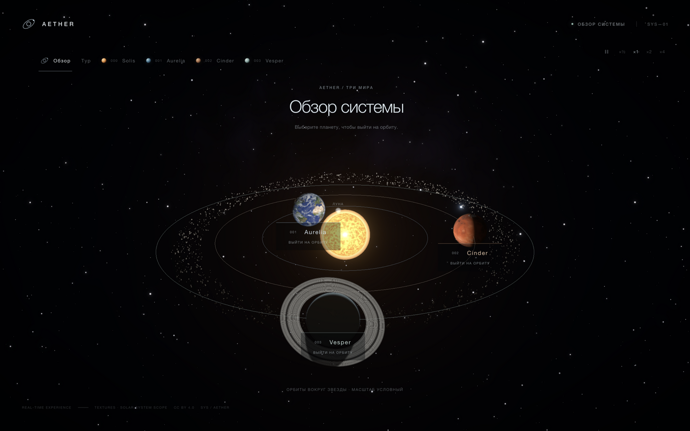
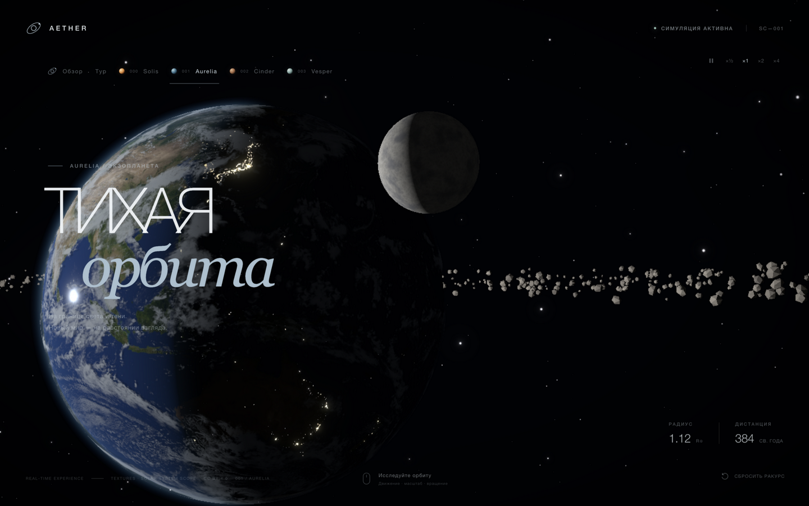
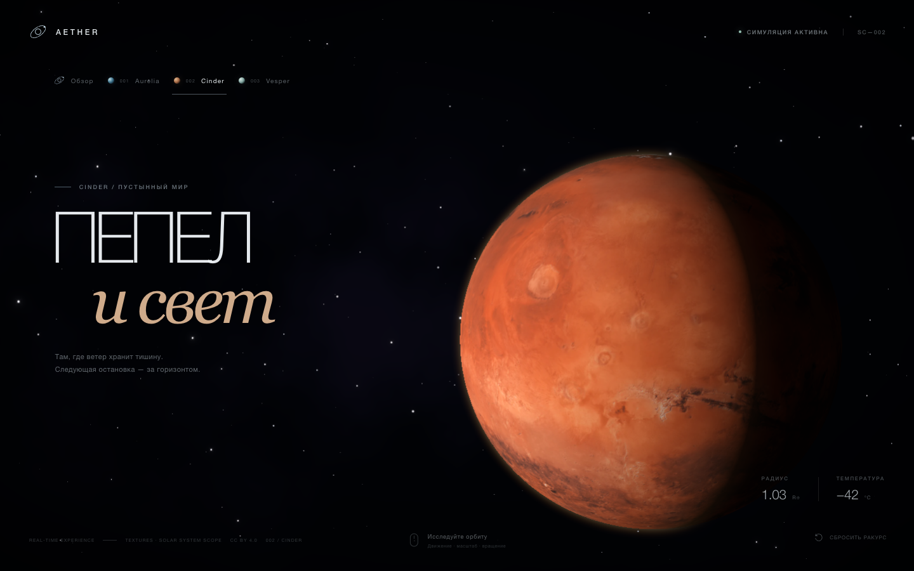
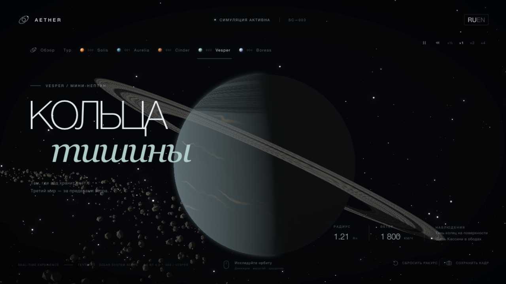
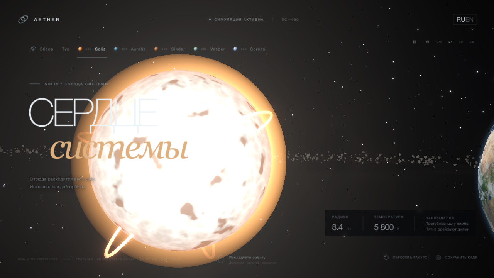
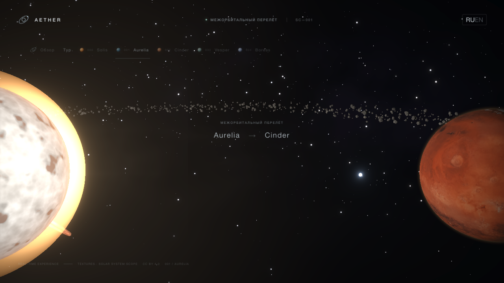
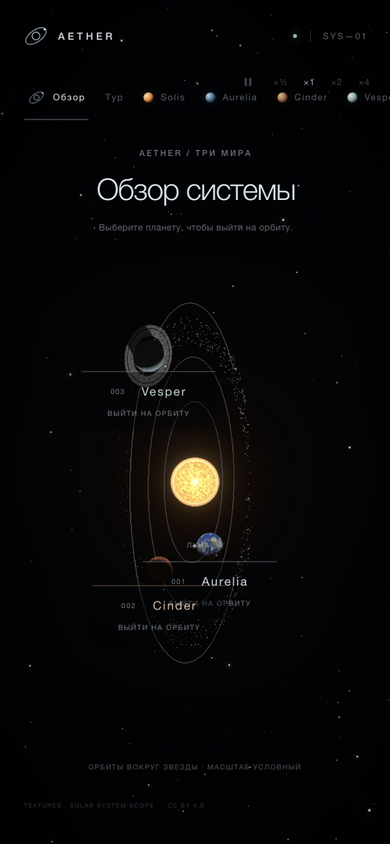

# AETHER — The Quiet Orbit

[Русская версия](README.md)

An interactive space scene in the browser: three fictional worlds, cinematic flights between them, and an overview of the system with thin orbit lines. No video or pre-renders — everything is computed in real time on WebGL.

**Live version: [aether-orbit-three.vercel.app](https://aether-orbit-three.vercel.app)**

[](https://github.com/4isper/aether-orbit/actions/workflows/ci.yml)



## What's inside

- **Solis** — a living star at the center of the system: a white-yellow 5800 K photosphere with procedural granulation, spots with a fibrous penumbra on their slow drift, limb darkening, a corona with streamers, and prominences — plasma loops anchored on two legs; each lives on its own cycle (rise, hold, decay, rest), rotates with the star, and fades into a dark filament when viewed face-on. Stared at up close, the star **glares back**: the frame floods the more the star centers in the view (`glare.ts`) — nearly invisible from the far orbit views. In the overview you can click the star and fly to a close orbit.
- **Aurelia** — an ocean world: a PBR surface (albedo, normal, specular, night lights), a separate cloud layer with soft cloud shadows that follow its rotation. Across the day-lit water crawls the **sun glint**: a field of wave micro-slopes stirs the normal inside the specular lobe — the water's mirror sparkles on the shared clock, and at grazing angles near the limb the compact spot opens into a glittering path; pause and reversal replay the same sparkle. At the night poles auroras glow — ovals around the magnetic poles with swaying curtains that die out on the day side — and in the mid-latitude night **lightning flickers**: three deterministic cells on the shared clock (`lightning.ts`), each pinned to its spot in the cloud map, so pause and reverse replay the same storm. Around it, on an inclined orbit, circles its **moon Nox**: tidally locked, with procedural craters and seas, visible phases, and — when it crosses the star's disc — an annular transit as a dark silhouette plus a running penumbra with a warm tint across the surface. Nox is a full view of its own: via a button or the `?view=moon` deep link.
- **Cinder** — a desert world with rust-red terrain, procedural-noise micro-relief and a thin dusty atmosphere. Once per its slow cycle the desert is swallowed by a **dust storm** (`storms.ts`): a deterministic envelope — rise, hold, decay, rest — drives a dust veil in the surface shader; the terrain drowns in uneven patches of flat ochre and the terminator softens with scattered light. Pause and time reversal replay the same weather.
- **Vesper** — an icy mini-neptune: procedural bands and a storm, rings with gaps and the planet's shadow — and ring shadows on the planet itself: sunlight passing through the ring darkens the surface by ring density, so the Cassini gap and ring structure show up inside the shadow band. The gap is swept by a **shepherd** — a small icy moon pacing the break's core in the ring plane (`orbits.ts`: `vesperClock`). In free flight the rings gain depth: deterministic ice blocks scattered through the annulus grow in as you approach and vanish beyond seven units from the planet (`ring-rocks.ts`). Entirely texture-free.
- **Asteroid belt** — three rings of debris between the orbits of Cinder and Vesper; each rotates at its own angular speed, lit by the star. Along the belt lies zodiacal light — a warm haze of scattered starlight on dust: brightest near the star, fading outward. On Aurelia's own orbit, sixty degrees ahead, rides a **trojan** — a rock held at the L4 lagrange point, forever leading the planet around; the overview map tags it with a quiet L4 label. You can enter the belt: a button, the `?view=belt` deep link and the `7` key settle the camera onto a drifting anchor on the middle ring — debris streams past, zodiacal light glows from inside.
- **The comet** — a small icy guest, **Boreas**, on a Kepler-shaped orbit (e ≈ 0.7): it accelerates near pericenter inside Aurelia's orbit and swings out past Vesper. Two tails: the ion tail points straight away from the star, the dust tail is wider, warmer in color and curved along its orbital wake; both lengthen and brighten toward pericenter. You can fly to it — by button, from the overview map or via a deep link.
- **Erebus** — a dwarf world beyond Vesper: dark regolith patched with frost, a tilted eccentric ellipse, most of its year spent dark past the belt. Once per its slow year it **dips inside Vesper's orbit** — that is its event: a countdown chip on its view, the window and peak computed analytically from Kepler's equation (`erebus.ts`, the shared `kepler.ts` factory it owns with the comet). Fly there by button, from the overview map or via the `?view=erebus` deep link.
- **Atmospheres** — single-pass Rayleigh/Mie scattering along the view ray: a blue haze and glowing limb on Aurelia, a warm sunset transition at the terminator, a dusty tint on Cinder and an icy haze on Vesper. Night sides stay dark.
- **Sky** — 5400 stars with twinkle and adaptive point size; density rises toward a Milky Way band aligned with the nebula ribbon — the sky resolves into one galaxy. Rare meteors burn across it: three independent slots on deterministic cycles — pausing freezes a streak, reversing time replays it backwards. And once per a long cycle the sky turns into a **meteor shower**: six dense slots stream parallel trails from a single radiant — every rain has its own point in the sky (`meteors.ts`: `showerMeteor`), one envelope drives both the trails' brightness and the announcement.
- **Flights** — the camera swings out on an arc, changes angle and settles onto the chosen world's orbit in ~4 seconds; the interface hides while travelling.
- **Time controls** — pause, speed ×½–×4 and reverse: orbits, moon phases, the comet and the star's boiling slow down, speed up, freeze or run backwards; the camera stays alive in every mode.
- **Heliocentric system** — the star in the center, three slightly inclined orbits with slow planetary motion; lighting and terminators follow the direction to the star, so the planet phase changes along the orbit. Illumination falls with distance from Solis — Vesper receives half to a third of Aurelia's light (exponent 1.5 — an exposure compromise between the honest inverse square and a legible frame).
- **Event announcements** — the simulation is deterministic, so events are computed ahead by pure geometry: Nox's transit across Solis (from Aurelia's orbit), Nox's eclipse in Aurelia's shadow (from Nox's orbit), and Boreas's plunge toward perihelion (on the comet); `conjunction.ts` feeds the same scanner a different measure — from Cinder's orbit Vesper slips behind the star's disc, from Vesper's orbit Aurelia crosses it as a silhouette. The desert keeps its own weather too: on Cinder's orbit the storm (`storms.ts`) competes with Vesper's occultation, and whichever moment comes first takes the chip. And the meteor shower is the one event visible from every view: it joins every chip's candidate list under the same nearest-moment rule; the system overview, which owns no sky moment of its own, grows a chip only for it. Each shows a countdown chip with a "skip to the moment" button; the moment's beginning and the jump sound a short synthesized swell when sound is on.
- **Free flight** — the "Flight" button detaches the camera: WASD thrust, arrows and drag to look, Q/E down and up, wheel and pinch for impulse, Shift to boost (thrust and speed cap ×3) with a live HUD for speed and the nearest surface. Every body ahead carries its name in the void — a distant point of light answers for itself, markers and HUD distances from one position source (`flightBodyPosition`). Stare down Solis up close and the frame floods with glare. Escape or the button flies back to the regular orbit.
- **Ambient sound** — a quiet synthesized observation-deck background built from Web Audio, zero audio assets; the choice persists and resumes on the first gesture of the next visit. Beneath it live two cues: a boost hum while Shift is held in flight, and a slow octave-fall swell when an announced window begins or the "skip to the moment" jump lands.
- **Tour mode** — the "Tour" button runs an automatic circuit: Aurelia → Cinder → Vesper → the Belt → Boreas → Erebus → Solis → system overview, ~7 seconds per stop; any manual navigation stops the tour.
- **System overview** — all three worlds, the star and the asteroid belt in one frame; clicking a planet sphere, the star or a label starts a flight. Framing compensates for perspective so near planets stay inside the shot.
- **World card** — telemetry on orbit plus an "Observations" row: short hints on what to look for from this angle — auroras, ring shadows, prominences, both comet tails.
- **RU / EN** — the interface ships in two languages, a switch in the header, the choice persists between visits.
- **Keyboard shortcuts** — `Space` pauses time, `1–7` jump to views, `?` opens a shortcut cheat-sheet.
- **Share button** — copies a link to the exact view, camera pose and simulation moment (`?view=`, `?yaw=&pitch=&zoom=`, `?t=` — the URL contract lives in `deep-link.ts`); the deterministic clock means the link reproduces the sky, not just the framing, and jumping to an event writes the leap target into the address.
- **Adaptive quality** — canvas resolution steps between 0.85 and 1.75 DPR based on sustained FPS; the DOM interface stays crisp.
- **PWA** — the app installs to a home screen and keeps working offline: a manifest and a small service worker cache the shell, hashed chunks and textures (shell network-first, assets cache-first). Registered in production builds only.
- **Careful-motion mode** — with `prefers-reduced-motion` flights are instant, rotation and star twinkle are disabled.

Planet names and telemetry values are fictional: this is an art scene, not an astronomical model. Overview distances are illustrative.

## Screenshots

| Aurelia's orbit | Cinder's orbit |
| --- | --- |
|  |  |

| Vesper's rings | The star Solis |
| --- | --- |
|  |  |

| Flight between worlds |
| --- |
|  |



Every frame was captured from the running app, no post-processing.

## Running

Requires Node.js 20.19+ or 22.12+. In the browser — WebGL2: if WebGL is unavailable or the context is lost, the scene shows a hint instead of an endless loader.

```bash
npm install
npm run dev      # http://localhost:5173
```

Production build and preview:

```bash
npm run build
npm run preview
```

Linter and math tests (orbits, Kepler's equation, camera, prominence loops, ring shadows):

```bash
npm run lint
npm test
```

A headless smoke run of the built scene: it opens every view in a browser with software WebGL (SwiftShader) and fails if console errors appear — this is how CI catches GLSL compile errors before publishing. Needs an installed Chrome/Edge/Chromium:

```bash
npm run build
npm run test:smoke
```

## Controls

| Action | Result |
| --- | --- |
| Mouse / finger drag | Rotate the camera around the planet |
| Two-finger pinch | Zoom in and out (touch screen) |
| Mouse wheel, `+` / `-` | Zoom in and out |
| Arrow keys | Rotate the camera from the keyboard |
| `R` or the "Reset pose" button | Return to the initial view |
| `Space` | Pause and resume time |
| `1`–`9` | Jump to a view: Aurelia, Cinder, Vesper, Solis, Boreas, Nox, the Belt, Erebus, overview |
| `?` | Keyboard shortcut cheat-sheet |
| The "Overview" button | Full view of the system |
| Drag and wheel in the overview | Rotate and zoom the whole system |
| Click a planet or its label in the overview | Fly to that world's orbit |
| Click the star in the overview or the "Solis" button | Fly to the star |
| The "Boreas" button or its label in the overview | Fly to the comet |
| The "Nox" button | Fly to Aurelia's moon |
| ×½ · ×1 · ×2 · ×4 buttons | Simulation speed |
| The reverse button (◀◀ next to pause) | Time runs backwards: orbits, phases, the comet and the star's boiling reverse |
| The pause button | Stop and resume time |
| The "Tour" button | Automatic cinematic tour of the system |
| The RU / EN switch in the header | Change the interface language; the choice persists |
| The "Save frame" button | PNG of the current view with the view name in the file |
| The "Share" button | Copies a link to the current view and pose (system share sheet on mobile) |
| `H` (or `Р` on a Russian layout) | Cinema mode: hide and restore the interface |

Deep links: a URL like `?view=vesper` opens the scene straight on Vesper's orbit (`aurelia`, `cinder`, `vesper`, `moon`, `comet`, `star`, `belt`, `erebus`, `system`), and `?view=vesper&yaw=0.25&pitch=0.12&zoom=10.5` also restores a saved camera pose. The address updates on every arrival and during inspection, so the exact view can always be copied from the address bar.

The canvas is keyboard-accessible: focus, arrows and reset work without a mouse; the view switches and overview labels are regular buttons with aria-labels.

## Stack

- React 19 + TypeScript, built with Vite; three.js is split into a lazily loaded chunk
- Three.js via React Three Fiber and Drei
- Custom GLSL shaders: surface and clouds, atmosphere, the living star, the comet, asteroids, the star field, the backdrop
- `@react-three/postprocessing`: Bloom and Vignette, ACES Filmic tone mapping
- Oxlint and `node:test` for math checks, a headless shader smoke test and CI on GitHub Actions

## Structure

```
src/
  components/
    SpaceScene.tsx     # scene assembly, ready state, postprocessing
    SceneCanvas.tsx    # canvas, DPR adaptation, WebGL context recovery
    CameraRig.tsx      # inertial camera, flights, overview framing
    Star.tsx           # Solis: granulation, spots, corona, halo, prominences
    Planet.tsx         # Aurelia: PBR surface, clouds, auroras and their shadows
    Moon.tsx           # Aurelia's moon: craters, seas, eclipse shadow
    Cinder.tsx         # the second world's desert surface
    Vesper.tsx         # the icy mini-neptune: bands, storm, ring shadows
    Belt.tsx           # asteroid belt and zodiacal light
    Comet.tsx          # the comet: head, coma, ion and dust tails
    Atmosphere.tsx     # shared Rayleigh/Mie scattering, dusty variant
    SystemOverview.tsx # orbits, route, clickable labels
    Starfield.tsx      # twinkling stars: density grows toward the galactic band
    Meteors.tsx        # rare burn-ups: three slots on deterministic cycles
    Backdrop.tsx       # the nebula
  comet.ts             # the comet's Kepler orbit: Kepler's equation, positions, perihelion window
  prominences.ts       # prominence loops: arc between legs, life cycle
  meteors.ts           # meteors: deterministic spawns per cycle, tangential tracks
  ring-shadow.ts       # ring shadow geometry: ray-plane intersection
  galactic.ts          # the Milky Way: star directions along the galactic band
  camera-math.ts       # camera offsets, overview framing, pose serialization
  strings.ts           # interface strings: RU and EN dictionaries, locale
  *.test.ts            # math tests: orbits, comet and perihelion, camera, prominences, eclipses, meteors, ring shadows, the band
  shaders/noise.ts     # simplex/fbm for micro-relief
  planets.ts           # names, telemetry and the localized copy of worlds and star
  orbits.ts            # orbit radii, inclinations, speeds and phases; planet positions
  App.tsx / App.css    # interface, navigation, loader
public/textures/       # WebP maps and ATTRIBUTION.txt
docs/screenshots/      # frames for the READMEs
docs/rendering.md      # a map of the rendering decisions: atmospheres, star, rings, tails
```

## Performance

The scene targets 60 FPS: short scattering passes (5 samples along the view ray, 2 along the light), one extra cloud-shadow sample, a procedural star at ~10 noise samples per pixel, asteroids and both comet tails on InstancedMesh/Points, and stepped DPR from 0.85 to 1.75 driven by the PerformanceMonitor. If a device still cannot keep up, the heavy effects are dropped along with resolution — Bloom and Vignette — and the frame buffer is not preserved between frames: "Save frame" re-renders the scene once at the moment of the click.

The entry chunk is ~174 KB gzip (interface and React), three.js with the scene is ~189 KB gzip loaded under the loader. The math tests, build and headless scene smoke run in CI on Node 22 and 24, with the Node 20 build checked in a separate job.

A fresh measurement in mobile emulation (390×844, DPR 1) on desktop hardware: the heaviest views — Aurelia's orbit with textures, clouds and atmosphere, and the procedural star view — hold the display ceiling (144 FPS) in both cases. That number reflects the desktop GPU, not a phone; on weaker devices quality steps down automatically, but the actual FPS on a physical phone remains unmeasured.

## Textures and attribution

Surface and cloud maps come from [Solar System Scope](https://www.solarsystemscope.com/textures/), licensed [CC BY 4.0](https://creativecommons.org/licenses/by/4.0/). The maps are downscaled and re-encoded as WebP; the shader uses the specular map as a roughness mask and the cloud map as a density and shadow mask. Details and the list of source files: [`public/textures/ATTRIBUTION.txt`](public/textures/ATTRIBUTION.txt).

## License

The project code is [MIT](LICENSE). The textures remain under CC BY 4.0 and require attribution when reused; the MIT license does not cover them.
