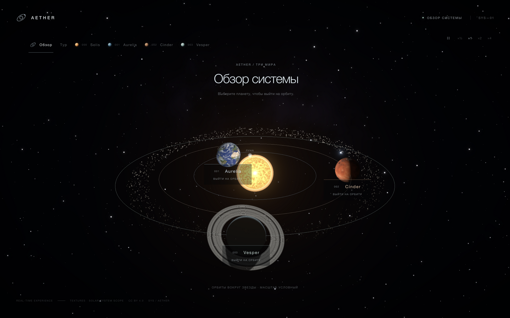
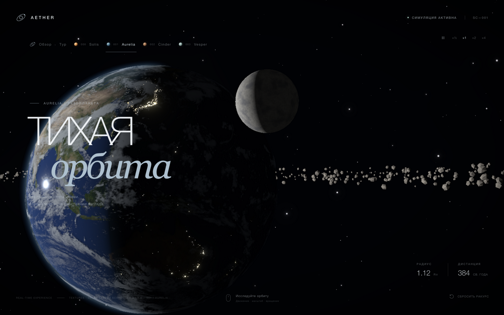
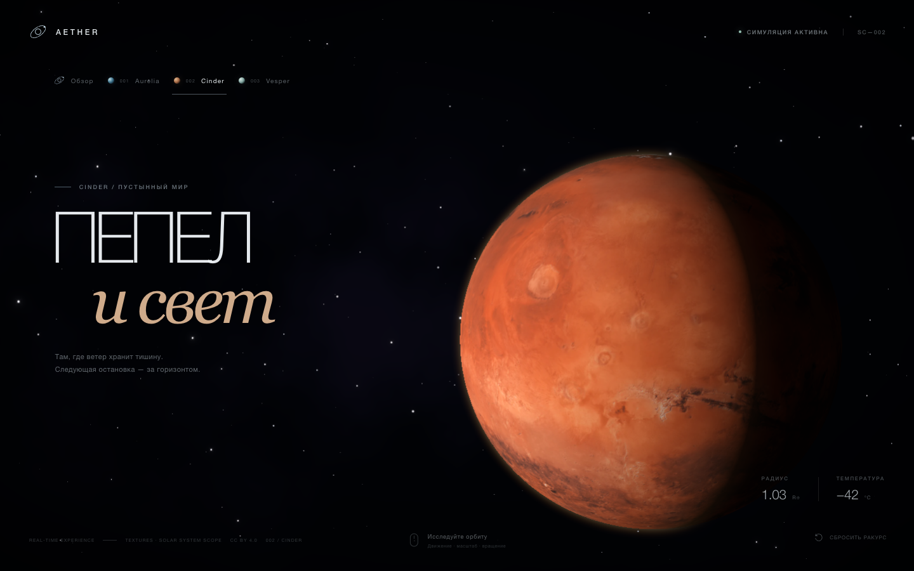
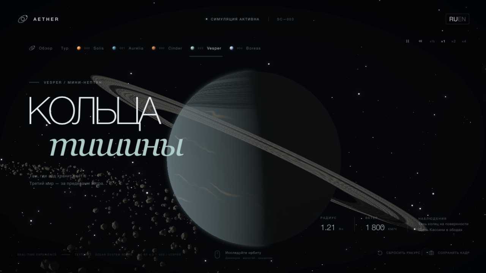
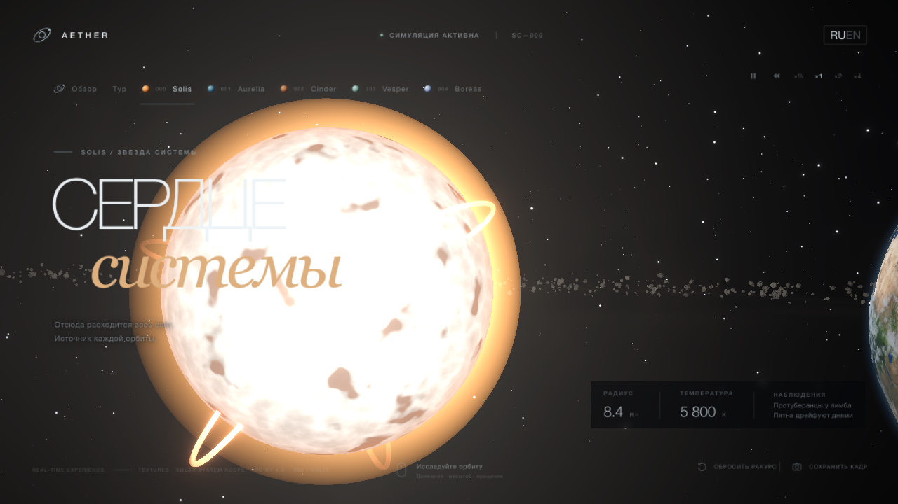
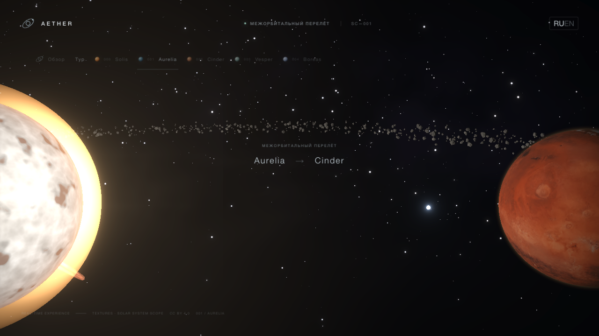
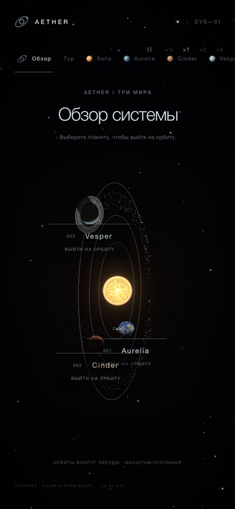

# AETHER — Тихая орбита

[English version](README.en.md)

Интерактивная космическая сцена в браузере: три вымышленных мира, кинематографичные перелёты между ними и обзор системы с тонкими орбитами. Без видео и предрендеров — всё считается в реальном времени на WebGL.

**Живая версия: [aether-orbit-three.vercel.app](https://aether-orbit-three.vercel.app)**

[](https://github.com/4isper/aether-orbit/actions/workflows/ci.yml)



## Что внутри

- **Solis** — живая звезда в центре системы: бело-жёлтая фотосфера 5800 K с процедурной грануляцией, пятна с волокнистой полутенью на своём медленном дрейфе, потемнение к лимбу, корона со стримерами и протуберанцы — плазменные петли между двумя ножками на фотосфере; каждая живёт на своём цикле (подъём, удержание, распад, покой), вращается вместе со звездой и гаснет при взгляде в лоб, как тёмное волокно на диске. В обзоре по звезде можно кликнуть и выйти на близкую орбиту.
- **Aurelia** — океанический мир: PBR-поверхность (albedo, normal, specular, ночные огни), отдельный облачный слой и мягкие тени от облаков, которые следуют за её вращением. На ночной стороне у полюсов светятся авроры — овалы магнитных полюсов с шевелящимися занавесями, которые гаснут на дневной стороне. Вокруг неё по наклонной орбите обращается **луна Nox**: приливной захват, процедурные кратеры и моря, видимые фазы, а при пересечении диска светила — кольцевой транзит тёмным силуэтом и бегущая полутень с тёплым оттенком на поверхности. На Nox можно перелететь отдельным видом — кнопкой или диплинком `?view=moon`.
- **Cinder** — пустынный мир с рыжим рельефом, микрорельефом из процедурного шума и тонкой пыльной атмосферой.
- **Vesper** — ледяной мини-нептун: процедурные полосы и шторм, кольца с щелями и тенью планеты — и с тенями колец на самой планете: солнечный луч, проходя сквозь кольцо, затемняет поверхность по плотности кольца, поэтому в полосе тени проступают щель Кассини и структура ободов. Полностью без текстур.
- **Пояс астероидов** — три кольца обломков между орбитами Cinder и Vesper; каждое вращается со своей угловой скоростью, освещение считается от звезды. Вдоль пояса лежит зодиакальный свет — тёплая дымка рассеянного звёздного света на пыли: ярче всего у звезды, тает к внешним орбитам.
- **Комета** — маленький ледяной гость **Boreas** на орбите кеплеровской формы (e ≈ 0.7): разгоняется у перицентра внутри орбиты Aurelia, уходит за орбиту Vesper. Хвоста два: ионный тянется строго от звезды, пылевой — шире, теплее цветом и изогнут по следу орбиты, как настоящий отстающий шлейф пыли; оба удлиняются и разгораются по мере приближения к перицентру. На неё можно перелететь — кнопкой, с обзорной карты или по диплинку.
- **Атмосферы** — однократное Rayleigh/Mie-рассеяние по лучу зрения: голубая дымка и светящийся лимб у Aurelia, тёплый закатный переход у терминатора, пыльный оттенок у Cinder и ледяная дымка у Vesper. Ночная сторона остаётся тёмной.
- **Небо** — 5400 звёзд с мерцанием и адаптивным размером точек; плотность растёт к полосе Млечного пути, согласованной с лентой туманности, — небо собирается в одну галактику.
- **Перелёты** — камера отходит по дуге, меняет угол обзора и выходит на орбиту выбранного мира за ~4 секунды; интерфейс на это время скрывается.
- **Управление временем** — пауза, скорость ×½–×4 и обратный ход: орбиты, фазы Луны, комета и кипение звезды замедляются, ускоряются, замирают или текут вспять; камера при этом остаётся живой в любом режиме.
- **Анонс событий** — симуляция детерминирована, поэтому следующий транзит Nox по диску Solis вычисляется наперёд чистой геометрией (`eclipse.ts`: пересечение оси тени с диском, уточнение границ бисекцией). На орбите Aurelia показывается чип с обратным отсчётом и кнопкой «К моменту», прыгающей к пику события.
- **Эмбиент** — тихий синтезированный фон наблюдательной палубы: два низких осциллятора, шум за низкочастотным фильтром и медленное «дыхание» на LFO. Ноль аудио-ассетов — всё собирается Web Audio по первому клику на кнопку звука.
- **Гелиоцентрическая система** — звезда в центре, три слегка наклонённые орбиты с медленным движением планет по ним; освещение и терминаторы считаются от направления на звезду, поэтому фаза планеты меняется по мере движения. Освещённость падает с удалением от Solis — Vesper получает вдвое-втрое меньше света, чем Aurelia (степень 1.5 — экспозиционная условность между честным квадратом расстояния и читаемостью кадра).
- **Тур-режим** — кнопка «Тур» включает автоматический обход: Aurelia → Cinder → Vesper → Boreas → Solis → обзор системы, по ~7 секунд на каждой остановке; любое ручное перемещение останавливает тур.
- **Свободный полёт** — кнопка «Полёт» отцепляет камеру: WASD — тяга по курсу, стрелки и перетаскивание — обзор, Q/E — вниз и вверх, колесо и щипок — импульс вперёд-назад. Движение с инерцией: отпускание клавиш плавно гасит ход, границы не дают влететь в Solis и улететь за систему. Escape или кнопка «Полёт» возвращает на орбиту обычным перелётом.
- **Обзор системы** — все три мира, звезда и пояс астероидов в одном кадре; клик по сфере планеты, звезде или подписи запускает перелёт. Кадрирование учитывает перспективу, чтобы ближние планеты не выходили за кадр.
- **Карточка мира** — телеметрия на орбите дополнена строкой «Наблюдения»: короткие подсказки о том, что искать с этого ракурса — авроры, тень колец, протуберанцы, оба хвоста кометы.
- **RU / EN** — интерфейс на двух языках, переключатель в шапке, выбор сохраняется между визитами.
- **Адаптивное качество** — разрешение Canvas меняется ступенями от 0.85 до 1.75 DPR по устойчивому FPS, DOM-интерфейс остаётся чётким.
- **Бережный режим** — при `prefers-reduced-motion` перелёты мгновенные, вращение и мерцание звёзд отключаются.
- **PWA** — приложение устанавливается на домашний экран и продолжает работать без сети: манифест и маленький service worker кешируют оболочку, хешированные чанки и текстуры (оболочка — network-first, ассеты — cache-first). Регистрация только в production-сборке.

Названия планет и параметры в телеметрии вымышлены: это художественная сцена, а не астрономическая модель. Масштаб расстояний в обзоре условный.

## Скриншоты

| Орбита Aurelia | Орбита Cinder |
| --- | --- |
|  |  |

| Кольца Vesper | Звезда Solis |
| --- | --- |
|  |  |

| Перелёт между мирами |
| --- |
|  |



Все кадры сняты с работающего приложения, без постобработки.

## Запуск

Нужен Node.js 20.19+ или 22.12+. В браузере — WebGL2: если WebGL недоступен или контекст теряется, сцена покажет подсказку вместо бесконечной загрузки.

```bash
npm install
npm run dev      # http://localhost:5173
```

Production-сборка и предпросмотр:

```bash
npm run build
npm run preview
```

Линтер и тесты математики (орбиты, уравнение Кеплера, камера, петли протуберанцев, тени колец):

```bash
npm run lint
npm test
```

Headless smoke-прогон собранной сцены: открывает все виды в браузере с программным WebGL (SwiftShader) и падает, если в консоли появляются ошибки — так CI ловит ошибки компиляции GLSL до публикации. Нужен установленный Chrome/Edge/Chromium:

```bash
npm run build
npm run test:smoke
```

## Управление

| Действие | Результат |
| --- | --- |
| Перетаскивание мышью / пальцем | Поворот камеры вокруг планеты |
| Сведение и разведение двух пальцев | Приближение и отдаление (сенсорный экран) |
| Колесо мыши, `+` / `-` | Приближение и отдаление |
| Стрелки | Поворот камеры с клавиатуры |
| `R` или кнопка «Сбросить ракурс» | Возврат к исходному виду |
| Кнопка «Обзор» | Общий план системы |
| Перетаскивание и колесо в обзоре | Вращение и приближение системы целиком |
| Клик по планете или её подписи в обзоре | Перелёт на орбиту этого мира |
| Клик по звезде в обзоре или кнопка «Solis» | Перелёт к звезде |
| Кнопка «Boreas» или её подпись в обзоре | Перелёт к комете |
| Кнопка «Nox» | Перелёт к луне Aurelia |
| Кнопки ×½ · ×1 · ×2 · ×4 | Скорость симуляции |
| Кнопка обратного хода (◀◀ рядом с паузой) | Время течёт назад: орбиты, фазы, комета и кипение звезды движутся в обратную сторону |
| Кнопка паузы | Остановка и возобновление времени |
| Кнопка звука (динамик рядом со скоростями) | Включение и выключение эмбиента |
| Кнопка «К моменту» в чипе транзита | Прыжок симуляции к пику транзита Nox |
| Кнопка «Тур» | Автоматический кинематографичный обход системы |
| Кнопка «Полёт» | Свободный полёт: WASD — движение, стрелки — обзор, Q/E — вниз/вверх, колесо — импульс |
| `Escape` | Выйти из свободного полёта (и справки, и режима кино) |
| Переключатель RU / EN в шапке | Смена языка интерфейса; выбор сохраняется |
| Кнопка «Сохранить кадр» | PNG текущего вида с именем вида в имени файла |
| Кнопка «Поделиться» | Копирует ссылку на текущий вид и ракурс (на мобильных — системный шеринг) |
| `H` (или `Р` на русской раскладке) | Режим кино: скрыть и вернуть интерфейс |
| `Space` | Пауза и возобновление времени |
| `1`–`7` | Перелёт к виду: Aurelia, Cinder, Vesper, Solis, Boreas, Nox, обзор |
| `?` | Справка по горячим клавишам |

Deep links: ссылка вида `?view=vesper` открывает сцену сразу на орбите Веспера (`aurelia`, `cinder`, `vesper`, `moon`, `comet`, `star`, `system`), а `?view=vesper&yaw=0.25&pitch=0.12&zoom=10.5` — ещё и с сохранённым ракурсом камеры. Адрес обновляется при каждом прибытии и во время осмотра, так что точный вид всегда можно скопировать из строки браузера.

Canvas доступен с клавиатуры: фокус, стрелки и сброс работают без мыши; переключатели планет и подписи обзора — обычные кнопки с aria-метками.

## Стек

- React 19 + TypeScript, сборка на Vite; three.js выделен в лениво загружаемый чанк
- Three.js через React Three Fiber и Drei
- Собственные GLSL-шейдеры: поверхность и облака, атмосфера, живая звезда, комета, астероиды, звёздное небо, фон
- `@react-three/postprocessing`: Bloom и Vignette, тонмаппинг ACES Filmic
- Oxlint и `node:test` для проверок математики, headless smoke-тест шейдеров и CI на GitHub Actions

## Структура

```
src/
  components/
    SpaceScene.tsx     # сборка сцены, ready-состояние, постобработка
    SceneCanvas.tsx    # Canvas, DPR-адаптация и восстановление WebGL-контекста
    CameraRig.tsx      # инерционная камера, перелёты, кадрирование обзора
    Star.tsx           # Solis: грануляция, пятна, корона, гало и протуберанцы
    Planet.tsx         # Aurelia: PBR-поверхность, облака, авроры и их тени
    Moon.tsx           # луна Aurelia: кратеры, моря, тень затмения
    Cinder.tsx         # пустынная поверхность второго мира
    Vesper.tsx         # ледяной мини-нептун: полосы, шторм и кольца с тенями
    Belt.tsx           # пояс астероидов и зодиакальный свет
    Comet.tsx          # комета: голова, кома, ионный и пылевой хвосты
    Atmosphere.tsx     # общее Rayleigh/Mie-рассеяние, вариант с пылью
    SystemOverview.tsx # орбиты, маршрут и кликабельные подписи
    Starfield.tsx      # звёзды с мерцанием: плотность растёт к галактической полосе
    Backdrop.tsx       # туманность
  comet.ts             # кеплеровская орбита кометы: уравнение Кеплера, позиции
  prominences.ts       # петли протуберанцев: дуга между ножками, жизненный цикл
  ring-shadow.ts       # геометрия тени колец: пересечение луча солнца с плоскостью
  eclipse.ts           # геометрия затмений: ось тени луны, окно транзита, скан наперёд
  galactic.ts          # Млечный путь: направления звёзд вдоль галактической полосы
  camera-math.ts       # смещения камеры, кадрирование обзора, сериализация ракурса
  strings.ts           # интерфейсные строки: RU и EN словари, локаль
  *.test.ts            # тесты математики орбит, кометы, камеры, протуберанцев, теней колец и полосы
  shaders/noise.ts     # simplex/fbm для микрорельефа
  planets.ts           # имена, телеметрия и локализованная копия миров и звезды
  orbits.ts            # радиусы, наклоны, скорости и фазы орбит; позиции планет
  App.tsx / App.css    # интерфейс, навигация, loader
public/textures/       # WebP-карты и ATTRIBUTION.txt
docs/screenshots/      # кадры для этого README
docs/rendering.md      # карта рендер-решений: атмосферы, звезда, кольца, хвосты
```

## Производительность

Сцена целится в 60 FPS: короткие проходы рассеяния (5 сэмплов по лучу, 2 по свету), один дополнительный сэмпл облачной тени, процедурная звезда на ~10 сэмплах шума за пиксель, астероиды и оба хвоста кометы на InstancedMesh/Points, и ступенчатый DPR от 0.85 до 1.75 по показателям PerformanceMonitor. Если устройство всё равно не держит темп, вместе с разрешением отключаются и тяжёлые эффекты — Bloom и Vignette, а буфер кадра не сохраняется между кадрами: «Сохранить кадр» перерисовывает сцену один раз в момент нажатия.

Входной чанк — ~174 КБ gzip (интерфейс и React), three.js со сценой — ~189 КБ gzip, которые догружаются под лоадером. Тесты математики, сборка и headless smoke-прогон сцены гоняются в CI на Node 22 и 24, сборка на Node 20 проверяется отдельным job.

Свежий замер в мобильной эмуляции (390×844, DPR 1) на настольном железе: самые тяжёлые виды — орбита Aurelia с текстурами, облаками и атмосферой и вид процедурной звезды — держат потолок дисплея (144 FPS) в обоих случаях. Это число отражает возможности десктопного GPU, а не телефона; на слабых устройствах качество снижается автоматически, но актуальный FPS на физическом телефоне по-прежнему не измерялся.

## Текстуры и атрибуция

Карты поверхностей и облаков — [Solar System Scope](https://www.solarsystemscope.com/textures/), лицензия [CC BY 4.0](https://creativecommons.org/licenses/by/4.0/). Карты уменьшены и пережаты в WebP; specular-карта используется шейдером как маска шероховатости, облачная — как маска плотности и теней. Подробности и список исходных файлов: [`public/textures/ATTRIBUTION.txt`](public/textures/ATTRIBUTION.txt).

## Лицензия

Код проекта — [MIT](LICENSE). Текстуры остаются под CC BY 4.0 и требуют атрибуции при повторном использовании; MIT на них не распространяется.